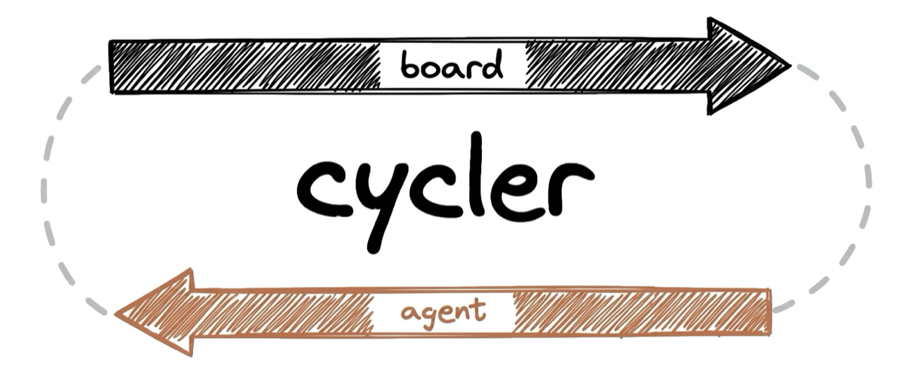
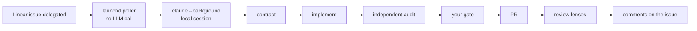

<p align="center">
  <picture>
    <source media="(prefers-color-scheme: dark)" srcset="docs/assets/logo-dark.png">
    <source media="(prefers-color-scheme: light)" srcset="docs/assets/logo-light.png">
    
  </picture>
</p>

<h1 align="center">Assign a Linear issue to a local Claude Code harness. Get a gated PR back.</h1>

<p align="center">
  On your Mac · your repo · your gate · no hosted Cycler service or tunnel
</p>

<p align="center">
  <a href="https://github.com/mikhailkogan17/cycler/releases/latest"></a>
  <a href="LICENSE"></a>
  
  
</p>

---

<!-- DEMO: 2-min video/GIF -->
<!-- Real PR produced by cycler: https://github.com/mikhailkogan17/cycler/pull/40 -->

## What it does

- **Turns a Linear delegation into a local session.** A launchd job polls every 180 seconds without an LLM call or webhook, then starts `claude --background` in your repo.
- **Checks the work before opening a PR.** The session writes a contract, implements it, gets an independent audit, and runs your repo's gate. Three independent review lenses then inspect the PR and drive fixes.
- **Reports back on the issue.** Cycler comments when a session starts, needs answers, opens a PR, or fails. A human decides whether to merge.



[See a PR produced by a Cycler workflow](https://github.com/mikhailkogan17/cycler/pull/40).

## Quickstart

**Requirements:** macOS (launchd), Node 18+, [Claude Code](https://claude.com/claude-code), and a Linear workspace where you can create an OAuth application.

1. Install the plugin in a terminal:

   ```bash
   claude plugin marketplace add mikhailkogan17/cycler
   claude plugin install cycler@cycler
   ```

2. In Linear, go to **Settings → API → Applications → New application**. Name it `Cycler`; set the callback URL to `http://localhost:8787/callback`; leave webhooks off. The authorization flow requests `read`, `write`, `app:assignable`, and `app:mentionable` scopes. Copy its Client ID and Client secret. Use an OAuth application, not a personal API key: the app is the agent that issues can be delegated to.
3. Open Claude Code **in the repo that should receive PRs** by running `claude` in its directory. At the Claude Code prompt, enter `/cycler:start`. It guides you through the config, browser authorization, gate check, and launchd setup. The command is safe to rerun.
4. Delegate an issue to the `Cycler` agent in Linear. The poller picks it up within 180 seconds; `/cycler:delegate <KEY>` in Claude Code can dispatch one immediately.

**Access boundary:** anyone who can delegate an issue to this agent can run code on your machine through the dispatched session. Restrict delegation in a shared workspace.

## Alternatives

The board can hand work to plenty of agents. What cycler does differently is run it with **no hosted
Cycler component in the path** — no hub or relay — and install as a
Claude Code plugin rather than a service you deploy and keep alive.

| Project | |
|---|---|
| [**cyrus**](https://github.com/cyrusagents/cyrus) | Its own harness and its own child agents. BYOK, so its token cost is yours, and the workflow isn't. Paid tiers route through their cloud. |
| [**Symphony**](https://github.com/openai/symphony) | Also polls the board — but Codex only, and it ships as a spec plus an Elixir reference implementation, not something you install. |
| [**Multica**](https://github.com/multica-ai/multica) | A self-hostable workspace you run and operate. Drives 20 agent CLIs; the setup is a platform, not a plugin. |
| [**zeroshot**](https://github.com/the-open-engine/zeroshot) | Planner, implementer and validators looping until verified. Strong on verification, but you point it at an issue — the board doesn't delegate to it. |
| [**flow-next**](https://github.com/gmickel/flow-next) | Syncs specs to Linear two-way, but *you* start every run. The board can't trigger one. |
| **Copilot / Codex Linear Agent** | Cloud execution only. No choice of gate, no choice of workflow, and your repo leaves your machine. |

---

## Usage
### Commands
| command | does |
|---|---|
| `/cycler:start` | set up whatever is missing, then start polling |
| `/cycler:stop` | unload the launchd job |
| `/cycler:delegate <KEY>` | put one issue on the agent and dispatch it now — the board's assign button, from here |
| `/cycler:doctor` | diagnose the nine things that actually break |

> [!TIP]
> `/cycler:start` checks your setup and guides you through the missing config, OAuth authorization,
> and launchd job. Create the Linear OAuth application in the Quickstart first. Safe to re-run.

> [!CAUTION]
> **Anyone who can delegate an issue to the agent can run code on your machine.**
> The issue becomes the prompt of a Claude Code session in your repo.
> On a shared one, restrict who can assign your issues to an agent.

### Workflows
| workflow | for |
|---|---|
| `/cycler:workflow-feature` | a feature, improvement, tech debt — contract → implement → audit → gate → PR |
| `/cycler:workflow-bug` | the same lifecycle in bugfix mode: the regression test comes before the fix |
| `/cycler:workflow-research` | a question whose deliverable is a decision, not a diff. No contract, no gate |
| `/cycler:workflow-intake` | writing a contract by hand first, then handing it to `workflow-feature`. Optional |
| `/cycler:workflow-review` | review an existing GitHub PR independently of Linear and implementation; publish validated inline comments |

> [!IMPORTANT]
> The poller selects a configured task or research workflow for delegated issues. You can also run
> workflows in the **current** session; `workflow-review` reviews an existing PR directly.

#### Codex, DeepSeek Harness, and standalone review

Select `dispatch.runtime: codex` or `dispatch.runtime: dsh` in the existing config. Configure the
absolute CLI path under `runtimes.<runtime>.bin`. Claude remains the default for existing installs.
Install the shared skill entry points with `node /path/to/cycler/harness/install-skills.mjs --repo /repo`.
Codex and dsh discover `.agents/skills`; Codex invokes them as `$cycler-workflow-feature`,
`$cycler-workflow-bug`, `$cycler-workflow-research`, or `$cycler-workflow-intake`.

`/cycler:workflow-review` (Codex: `$cycler-workflow-review`) reviews an existing GitHub PR,
independently of Linear and implementation. Set `review.runtime` or per-lens runtimes/models for
cross-model review. It publishes inline GitHub comments; fix rounds reply in the original threads
with the pushed commit and verification before re-reviewing. It never merges.

See [runtime setup, DSH authentication and review configuration](docs/specs/005-runtimes.md).

---

## Config

Path: `~/.config/cycler/config.yaml`.
Every key is optional.

```yaml
linear:
  client_id: ********
  client_secret: ********

repo:
  path: ~/your-repo
  base: main
  branch_prefix: claude/

workflows:
  default:  /cycler:workflow-feature   # contract → implement → audit → gate → PR
  bug:      /cycler:workflow-bug       # the same, in fix mode
  research: /cycler:workflow-research  # a decision, not a diff

dispatch:
  command: >
    claude --background --name "{session}" --remote-control "{session}"
    --remote-control-session-name-prefix linear --permission-mode auto
    --append-system-prompt "Started by cycler for {issue}" "{workflow} {issue}"
  path_prepend: [~/.local/bin, ~/bin, /opt/homebrew/bin, /usr/local/bin]
```

[**Example**](cycler.example.yaml)  |  [**Full reference**](docs/specs/002-config.md)

---

## Why the gate matters

**Green is only evidence if the check could have gone red.** A contract names the goal, allowed paths, and acceptance checks before source edits. The audit checks the resulting diff against that contract, and the repo's gate must pass for the exact tree being committed.

For Claude Code sessions in workflow worktrees, four `PreToolUse` hooks enforce the process:

1. `require-contract.sh` blocks source edits before the issue's contract exists.
2. `require-escape-hatch.sh` sends large changes through the full workflow instead of inline editing.
3. `confine-to-worktree.sh` blocks writes outside the session's worktree.
4. `require-green-gate.sh` blocks commits without a green gate for that tree.

The hooks apply to Claude Code's native workflow; [portable Codex and DeepSeek Harness runs](docs/specs/005-runtimes.md) run deterministic audit and gate checks before commit stages instead.

## Data handling

- **Network:** the poller calls Linear's OAuth and GraphQL APIs to read delegated issues and post comments. The workflow uses GitHub through `gh` for PRs and reviews. Dispatched Claude Code sessions send their prompts and repo context to Anthropic through the Claude CLI, or to the provider you configured for Claude Code. Optional Codex and DeepSeek Harness runtimes use their configured providers.
- **Local files:** `~/.config/cycler/config.yaml` holds the Linear OAuth Client ID and secret plus repo and dispatch settings. `~/.cycler/` holds the OAuth token, processed and pending issue state, and poller logs. Contracts, worktrees, gate results, and changes are stored in the repo or its worktrees; Claude Code manages its own session data.
- **Service:** Cycler has no hosted component, inbound webhook, or built-in telemetry. The poller makes no model call.

## Troubleshooting

`/cycler:doctor` checks all of these and tells you which one you have.

| symptom | cause |
|---|---|
| Worked yesterday, 401 today | Linear tokens expire in 24h; the refresh needs `client_id` and `client_secret` |
| Job loaded, nothing happens | `launchctl` addresses jobs by **label**; the plist filename has to match it |
| Session stalls asking where `node` is | launchd's bare `PATH` — set `dispatch.path_prepend` |
| The gate always passes | no `.claude/harness/gate.sh` and no lint/build/test script |

---

## Contributing

Spec → failing test → code → gate, in that order. [`CONTRIBUTING.md`](CONTRIBUTING.md) has the rest.

## Author

**[Mikhail Kogan](https://github.com/mikhailkogan17)**

## License

[`MIT`](LICENSE).
